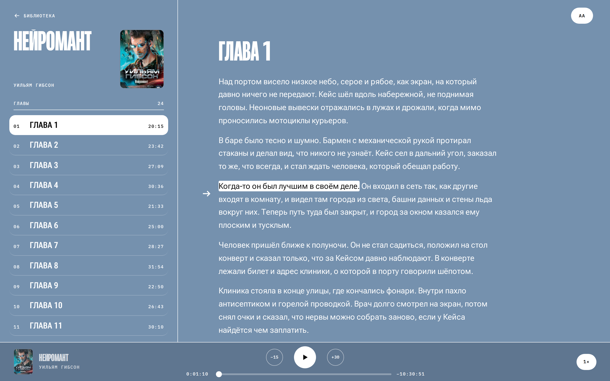

# audiobux

Озвучивает книги на вашей видеокарте. Загружаете PDF, DjVu или EPUB, получаете
аудиокнигу m4b с главами и EPUB с тем же текстом. Слушать можно в браузере:
плеер с главами и скоростью, рядом текст, где подсвечено то, что звучит. Сканы
распознаются, рисунки и таблицы пересказываются словами.

Инструмент для личных копий купленных книг, готовые m4b не распространяйте.



## Требования

- Debian 12 или 13.
- Видеокарта NVIDIA с драйвером: `nvidia-smi` должен показывать карту.
- Около 36 ГБ на диске: образы около 0,6 ГБ, рантайм моделей 6,3 ГБ и модели
  около 28 ГБ, рантайм и модели лежат в каталоге данных. Готовые книги
  занимают около 31 МБ на час звука.
- Интернет на время установки и первой загрузки моделей.

Docker и NVIDIA Container Toolkit установщик ставит сам. Внутри контейнера LXC
карта должна быть проброшена с хоста, остальное установщик настроит сам.

## Установка

```sh
git clone https://github.com/anysda/audiobux && cd audiobux
./install.sh
```

`install.sh` запускается от обычного пользователя (права root попросит через
`sudo`) или от root. Он ставит Docker и NVIDIA Container Toolkit, если их нет,
создаёт `.env` из `.env.example`, скачивает готовые образы последнего выпуска из
`ghcr.io/anysda/audiobux`, сверяет их digest со списком `images.txt` выпуска
на GitHub и запускает сервис. Образы лёгкие: web около 90 МБ,
worker около 470 МБ, torch и CUDA в них нет. В конце установщик печатает адрес
интерфейса и при первой установке - пароль входа (логин `admin`). Пароль
показывается один раз, сохраните его. Повторный запуск безопасен: пароль и
сертификат он не трогает.

Сначала интерфейс открыт только с самой машины, `https://127.0.0.1:8080`.
Чтобы открывать его с других устройств сети (например,
`https://192.168.1.10:8080`), впишите `AUDIOBUX_BIND=0.0.0.0` в `.env` и
запустите `./install.sh` снова.

### Если установка не удалась

- **«не найден nvidia-smi»** или **«nvidia-smi не видит карту»**. Установите
  драйвер (https://wiki.debian.org/NvidiaGraphicsDrivers), перезагрузите
  машину и запустите `./install.sh` снова. До этой проверки ничего не ставится.
- **«Docker не отвечает, а systemd здесь нет»**. Запустите `dockerd` сами и
  повторите `./install.sh`.
- **«не узнать последний выпуск»** или **«не скачался список образов
  выпуска»**. Ставится последний выпуск с GitHub: проверьте доступ к
  github.com и запустите `./install.sh` снова. Сразу после выхода выпуска его
  образы ещё собираются, повторите через несколько минут.
- **«образ ... не тот, что собран для выпуска»**. Образ под тегом выпуска
  отличается от собранного CI, установщик его не запустил. Удалите его
  (`docker image rm <образ>`) и запустите `./install.sh` снова; повторилось -
  образ в реестре подменён, сообщите об этом.
- **Порт 8080 занят.** Впишите другой порт в `AUDIOBUX_PORT` в `.env` и
  запустите `./install.sh` снова.
- **«воркер не поднялся за 300 с»**. На медленной машине первый запуск дольше:
  `AUDIOBUX_INSTALL_WAIT=900 ./install.sh`. Причина видна в журналах.

## Как пользоваться

Откройте адрес, который напечатал установщик, и загрузите книгу. Рантайм
моделей (3,86 ГБ, на диске 6,3 ГБ) и модели, около 28 ГБ, качаются один раз в
фоне, в своём контейнере: установщик их не ждёт, обрыв терминала или ssh
загрузку не прерывает, ход виден в интерфейсе. Книги ждут в очереди, пока
модели не скачаются. Если загрузка прервалась, интерфейс скажет «Модели не
скачались»: запустите `./install.sh` снова, она продолжится с того же места.
Книги озвучиваются по одной, в порядке загрузки. Если книга не озвучилась, в
интерфейсе видна причина и кнопка «Повторить»: повтор продолжает с того этапа,
где книга остановилась.

Тот же файл, загруженный ещё раз, - та же книга, второй раз она не
озвучивается.

Без входа страницы и API закрыты; кнопка «Выйти» - в шапке. Интерфейс
открывается по IP-адресу. Чтобы открывать его по имени,
впишите имя в `AUDIOBUX_HOSTS`, иначе страница ответит
`{"detail":"forbidden"}`.

Книги не покидают машину. Если у книги нет своей обложки, в сеть уходят только
автор и название: по ним обложка ищется на litres.ru и openlibrary.org.
Сам worker, который открывает книги, выхода в сеть не имеет.

Команды `docker compose` выполняются в каталоге `audiobux` от root или через
`sudo`. Журналы:

```sh
docker compose logs -f worker web
```

## Настройки

Настройки лежат в `.env` в каталоге `audiobux`. После правки:
`docker compose up -d`.

| Переменная | В `.env.example` | Что задаёт |
|---|---|---|
| `AUDIOBUX_DATA` | `./data` | каталог данных; относительный путь считается от каталога `audiobux` |
| `AUDIOBUX_UID`, `AUDIOBUX_GID` | `1000` | пользователь и группа процессов; `install.sh` ставит их по владельцу каталога данных |
| `AUDIOBUX_WORKER_DIGEST`, `AUDIOBUX_WEB_DIGEST`, `AUDIOBUX_COVER_DIGEST` | пусто | digest образов выпуска; `install.sh` пишет их из `images.txt` выпуска, вручную не менять |
| `AUDIOBUX_QUIET_HOURS` | пусто | тихие часы, например `00:00-08:00`; пусто - карта работает круглые сутки |
| `AUDIOBUX_HOSTS` | пусто | имена интерфейса через запятую, без порта, например `books.home.lan` |
| `AUDIOBUX_LOGIN` | `on` | вход по паролю; `off` - без входа, для обратного прокси со своим входом |
| `AUDIOBUX_BIND` | `127.0.0.1` | адрес, на котором открыт интерфейс; `0.0.0.0` - открыть в сеть |
| `AUDIOBUX_PORT` | `8080` | порт интерфейса, только HTTPS |
| `AUDIOBUX_UPLOAD_MB` | `1024` | самый большой файл книги, МБ |
| `AUDIOBUX_QUEUE_MAX` | `20` | сколько книг может ждать озвучки или озвучиваться; больше интерфейс не примет |
| `AUDIOBUX_MIN_FREE_GB` | `5` | при меньшем свободном месте в каталоге данных, ГБ, книга не примется |

### Вход и HTTPS

Пароль хранится только хэшем argon2 в `data/web/auth.db`, открытым текстом его
нет нигде. Сменить пароль (заодно закрываются все открытые входы):
`AUDIOBUX_PASSWORD='новый пароль' ./install.sh`. Пароль не короче 12
символов, более короткий установщик не примет.
С `AUDIOBUX_LOGIN=off` API и интерфейс открыты всем, кому виден порт: так
можно только за обратным прокси со своим входом, web предупреждает об этом в
журнале.

Интерфейс работает только по HTTPS с самоподписанным сертификатом, который
выпускает `install.sh` (`data/tls/`). Браузер при первом входе предупредит, что
сертификату не доверяет: его подписал не центр сертификации, а сама установка.
Предупреждение принимается один раз. Новый сертификат (например, после смены
адреса или `AUDIOBUX_HOSTS`): удалите `data/tls/` и запустите `./install.sh`.

### Тихие часы

Тихие часы считаются по времени сервера, пояс меняется на сервере
(`timedatectl set-timezone`).
Формат `ЧЧ:ММ-ЧЧ:ММ`, окно может переходить через полночь (`22:00-06:00`). В
эти часы новая книга не начинается, начатая встаёт на паузу и потом
продолжается с того же места. Если строка записана неверно, сервис не
запустится, причина будет в журнале.

## Обновление и удаление

Обновить:

```sh
git pull && ./install.sh
```

Книги, модели и настройки остаются, начатая книга продолжится с того же места.

Всё, что хранит сервис, лежит в каталоге `AUDIOBUX_DATA`. Резервная копия -
копия этого каталога, `models/` можно не копировать: модели скачаются заново.

Остановить: `docker compose down`, данные остаются. Удалить сервис вместе с
образами и данными (каталог `AUDIOBUX_DATA` вне `audiobux` удалите
отдельно):

```sh
docker compose down --rmi all
cd .. && rm -rf audiobux
```

Docker и NVIDIA Container Toolkit остаются в системе.

## Документация

- [docs/architecture.md](docs/architecture.md) - устройство сервиса, раскладка
  данных и [все переменные](docs/architecture.md#настройки) `AUDIOBUX_*`.
- [docs/development.md](docs/development.md) - разработка, проверки, тесты и
  сборка образов.
- [docs/openapi.json](docs/openapi.json) - описание API.

## Модели и лицензии

Код audiobux - под [MIT](LICENSE). Озвучивает модель
[F5-TTS_RUSSIAN](https://huggingface.co/Misha24-10/F5-TTS_RUSSIAN) автора
[Misha24-10](https://huggingface.co/Misha24-10) под лицензией
[CC-BY-NC-4.0](https://creativecommons.org/licenses/by-nc/4.0/): только
некоммерческое использование. Образец голоса взят из LibriVox (общественное
достояние), источник - в [voice/SOURCE.txt](voice/SOURCE.txt).
